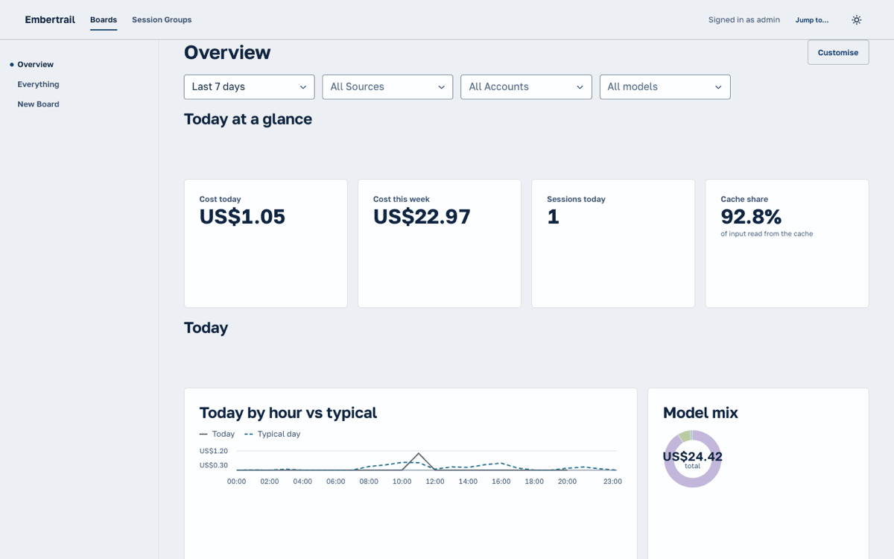
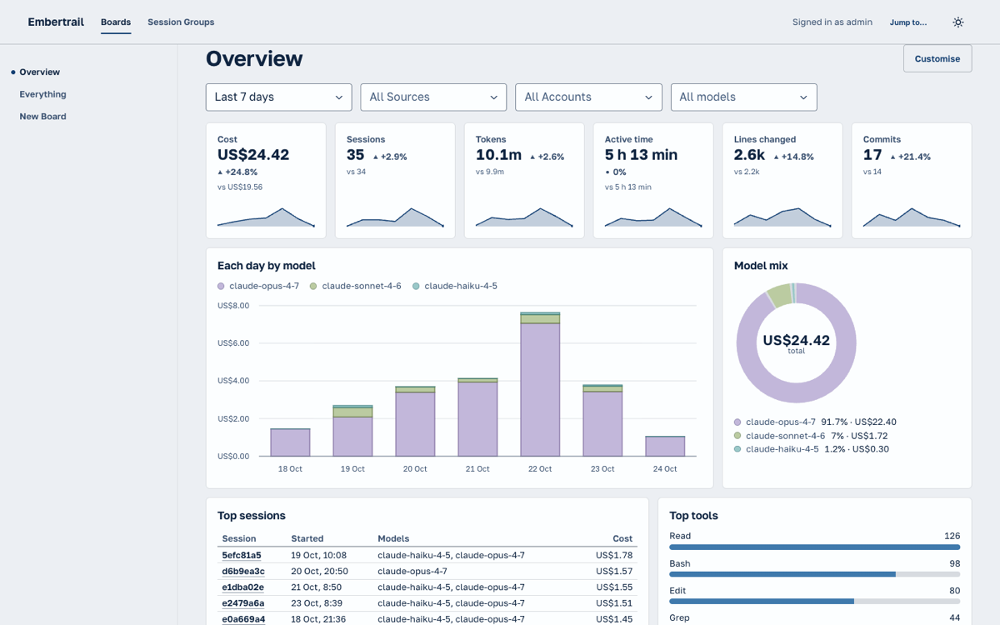
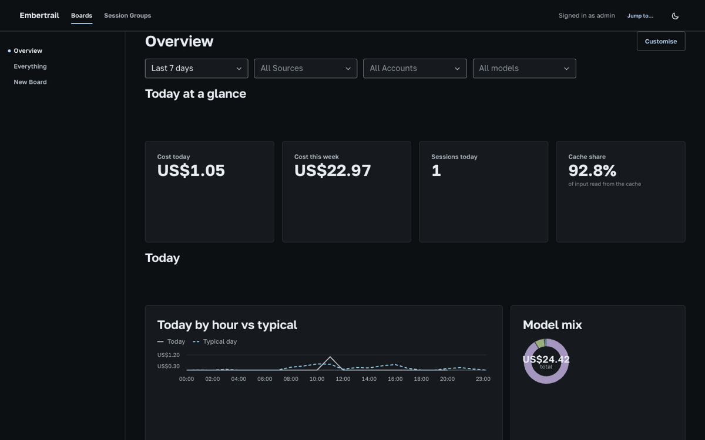
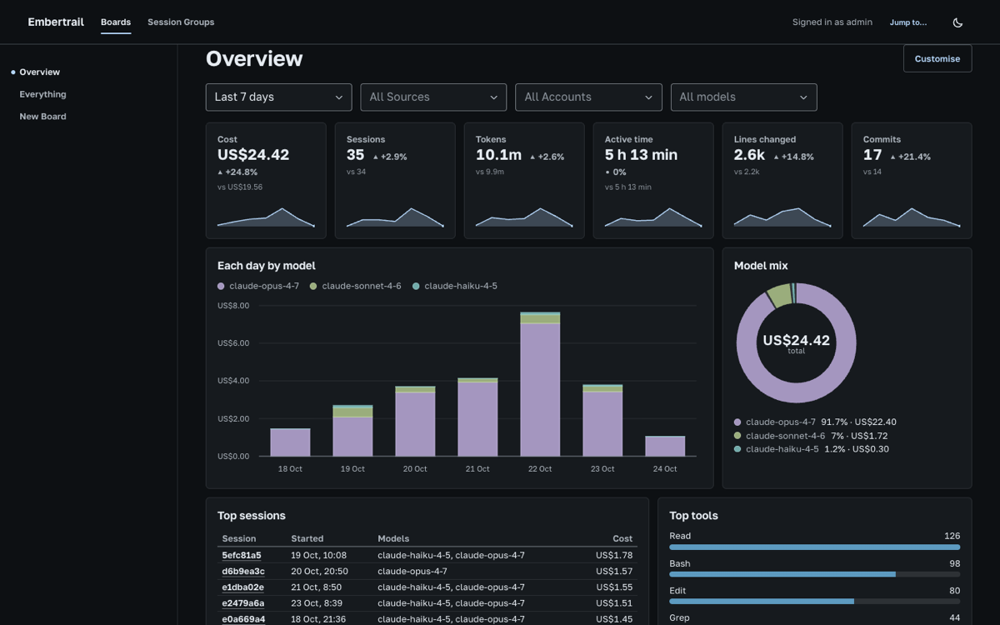
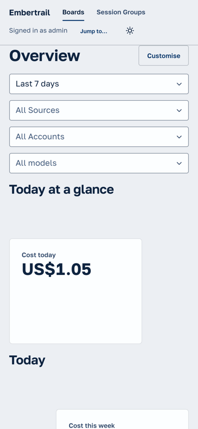
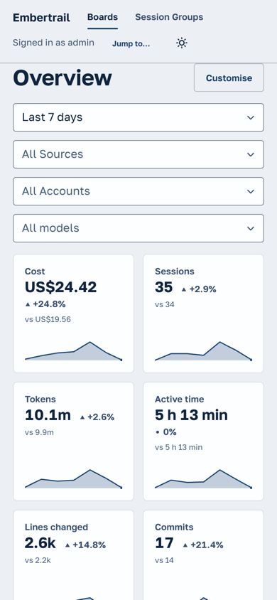
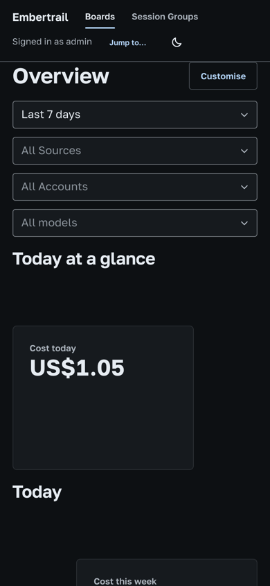
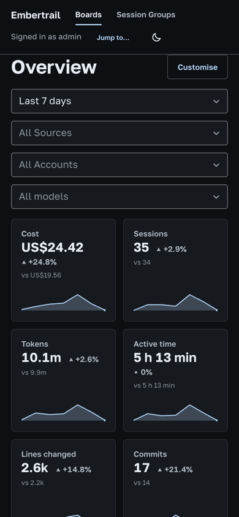

# Dashboard research: what comparable dashboards do

Research behind the Board and Widget redesign (Presets, density, KPIs, empty states). It covers general observability dashboards (Grafana, Datadog), LLM and AI-usage dashboards (Langfuse, Helicone, PostHog LLM analytics, Cloudflare AI Gateway, Anthropic's Claude Code analytics) and community Claude Code dashboards built on its OpenTelemetry export. Read in October 2026 from public docs; the sources are at the end. The rules this turned into are in [`dashboard.md`](dashboard.md#presets-and-density).

## What they show at the top

Every one of them opens with **a handful of headline numbers for the selected period** before any chart:

- **LLM dashboards** lead with totals: requests or traces, cost, tokens, latency, errors, users (Helicone, Langfuse's default Home, PostHog's LLM analytics dashboard, Cloudflare AI Gateway). Cost is always among them, usually first or second.
- **Claude Code dashboards** (Anthropic's analytics, community Grafana boards on the OTel export) lead with sessions, cost, tokens, lines of code, commits and active time, then break cost down by model.
- **Grafana and Datadog** put stat or query-value panels in the first row and charts below. Grafana's guidance is to go "large to small" and "general to specific".

The numbers follow **the dashboard's time range**, not a fixed day. A period total is what the time picker is for. "Today" figures are a separate view.

## KPI rows: a number, its change and its trend

- **Change against the previous period.** Datadog's query-value widget has a change indicator: relative, absolute or both, against the previous period or a chosen offset, coloured with increases as good, decreases as good, or neutral. Grafana's stat panel has a "percent change" with standard, inverted or same-as-value colouring.
- **A sparkline behind or under the number.** Grafana's stat panel draws an area sparkline (hidden automatically when the panel is too small). Datadog's query value can draw a timeseries background. The trend says whether the number is typical without opening a chart.
- **Neutral colour for usage.** Colour is kept for numbers with a clear good direction (errors, latency, budgets). Spend and activity are not good or bad by themselves, so they stay neutral (Datadog's "neutral", Kiln's `Stat` guidance: use a tone only when the number itself is the news).
- **Six to eight small tiles in one row.** The headline row is dense: equal widths, one line of label, the figure, the change, one line of context.

## Density and layout

- **Size each panel to its content.** A stat tile is short, a time series is wide and medium height, a ranked list or table is as tall as its rows. Nothing is a big card around a small figure.
- **Rows read as a story, top to bottom.** First the totals, then the trend over time (cost by day, by model), then the breakdowns (top sessions, tools, accounts), then the patterns (time of day, reliability). The community Claude Code dashboards follow this order: overview stats, cost and tokens over time, activity, leaderboards, distributions.
- **Pair charts across the row** (two or three per row, 8+4, 7+5, 6+6) instead of one full-width chart per row. Full-width is for the one chart that needs it.
- **Few or no section headings.** Grafana's rows are collapsible, slim and optional. Langfuse and PostHog use none on their default dashboards and let panel titles carry the meaning. A heading that costs as much height as a chart row is the largest single waste.
- **Fine grid rows.** Grafana's grid row is about 30px, so a stat can be short and a chart tall. A coarse row unit forces every tile to the same tall height.

## Guiding the eye

- The time range and filters sit directly above the numbers, so it is always clear what period a figure covers.
- The most important figure is top left; the first chart is the trend of that figure (cost → cost by day).
- One colour per series across every chart (a model keeps its colour), so the legend is learned once.
- Titles are short nouns ("Cost", "Sessions"), and comparison text is a few words ("vs $19.56"), with the full sentence on hover.

## Empty and loading states

- **Say why it is empty and what to do.** PostHog and Langfuse show setup instructions when a project has no data yet. An empty panel names the reason ("nothing matches these filters" against "nothing recorded in this period") rather than a generic "No data".
- **Distinguish a quiet period from no telemetry at all.** A whole dashboard of empty panels deserves one message at the top with the next step (widen the range, or connect the sender), not twenty identical empty cards.
- **Loading keeps the layout.** Skeletons hold each panel's size so nothing jumps when data lands. The Dashboard's `ChartFrame` already does this.

## What we took

| Practice                                           | Where it landed                                                                                   |
| -------------------------------------------------- | ------------------------------------------------------------------------------------------------- |
| A KPI row over the Board's range, first            | Six KPI Widgets (Cost, Sessions, Tokens, Active time, Lines changed, Commits) open the Overview   |
| Change against the previous period, neutral colour | Each KPI shows a signed percentage against the window of as many days before it                   |
| A sparkline under the number                       | Each KPI draws its window bucket by bucket, a quiet bucket as zero                                |
| Size to content, fine rows                         | The grid row is 3rem (it was 6rem); stats are 2 or 3 rows, charts 6                               |
| Charts paired across the row, no heading rows      | The Overview has no section headings; every row is full. Everything fills each row to 12 columns  |
| Charts fill their card                             | A chart at `fill` now takes the card's height instead of its minimum                              |
| Empty states that say why                          | "Nothing matches the filters" vs "Nothing recorded"; a Board-level "No telemetry" with one action |

## Before and after

The Overview on the demo dataset (`pnpm seed`), last 7 days, at 1440 × 900 and on a phone.

| Before                                                                     | After                                                                    |
| -------------------------------------------------------------------------- | ------------------------------------------------------------------------ |
|        |        |
|          |          |
|  |  |
|    |    |

## Sources

- Grafana: [Dashboard best practices](https://grafana.com/docs/grafana/latest/dashboards/build-dashboards/best-practices/), [Stat panel](https://grafana.com/docs/grafana/latest/panels-visualizations/visualizations/stat/), [Claude Code Metrics dashboard](https://grafana.com/grafana/dashboards/24993-claude-code-metrics/)
- Datadog: [Query Value widget](https://docs.datadoghq.com/dashboards/widgets/query_value/)
- Langfuse: [Custom dashboards](https://langfuse.com/docs/metrics/features/custom-dashboards)
- Helicone: [Metrics](https://mintlify.com/helicone/helicone/observability/metrics) (a mirror of Helicone's docs)
- PostHog: [LLM analytics dashboard](https://posthog.com/docs/ai-engineering/dashboard)
- Cloudflare: [AI Gateway analytics](https://developers.cloudflare.com/ai-gateway/observability/analytics/)
- Anthropic: [Claude Code Analytics API](https://platform.claude.com/docs/en/build-with-claude/claude-code-analytics-api), [Admin visibility into Claude usage and spend](https://claude.com/blog/giving-admins-more-visibility-and-control-over-claude-usage-and-spend)
