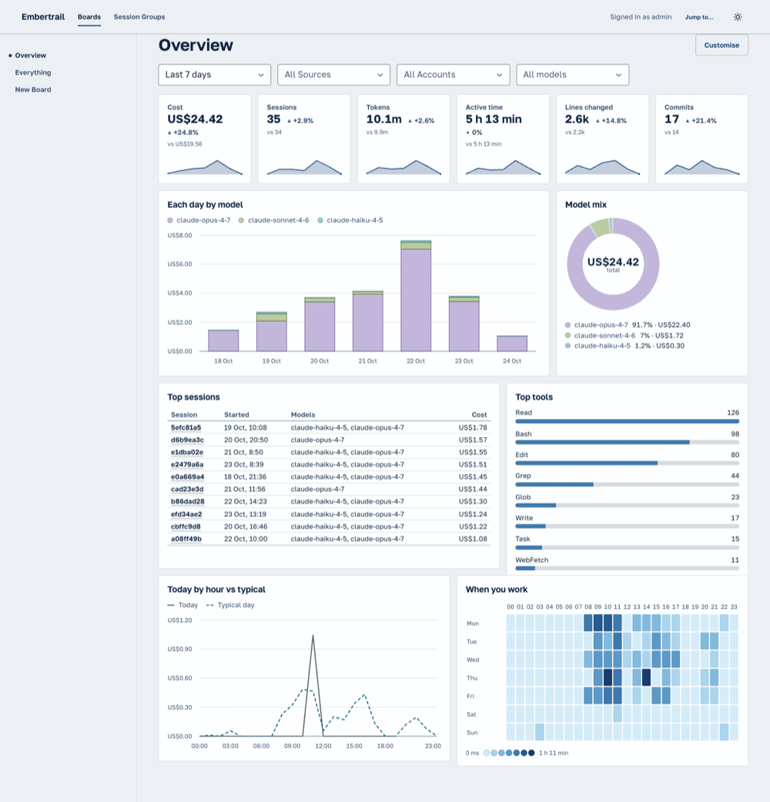

# Dashboard

The Dashboard (`apps/dashboard`, `@mitcsutt/embertrail-dashboard`, private) is a static single-page app that reads the Hub's Query API. The design is epic #51; the build plan is #72. This page is the canonical Dashboard doc: it grows with each task.



The Overview, the Everything Board, a Board in edit mode and the Session Groups view, from the seeded `embertrail-demo` dataset ([Everything](images/dashboard/everything.png), [edit mode](images/dashboard/edit-mode.png), [Session Groups](images/dashboard/session-groups.png)).

## Stack

- Vite 8 and React 19, with [Kiln](https://kiln.mitchellsutton.com): `kiln-ui` for the shell, `kiln-charts` for charts and `kiln-dnd` for the Board grid. The Paper theme is set before first paint by a script that the Vite config writes into `index.html`; the colour mode is stored under `embertrail-dashboard-mode`.
- TanStack Router (file routes in `src/routes/`, the generated `src/routeTree.gen.ts` is committed) and TanStack Query.
- The Dashboard reaches the Hub only through `@mitcsutt/embertrail-client`. ESLint bans every other workspace package and `fetch`, `XMLHttpRequest`, `EventSource` and `WebSocket` in `src/`; test files are exempt.

## Commands

From the repo root, filter to the package:

```sh
pnpm --filter @mitcsutt/embertrail-dashboard dev        # the shell on a Vite dev server
pnpm --filter @mitcsutt/embertrail-dashboard build      # dist/
pnpm --filter @mitcsutt/embertrail-dashboard preview    # serve dist/
pnpm --filter @mitcsutt/embertrail-dashboard test       # Vitest on jsdom
pnpm --filter @mitcsutt/embertrail-dashboard e2e        # Playwright on Chromium, see End-to-end tests
```

`pnpm lint`, `pnpm typecheck` and `pnpm test` at the root cover it too.

### The development loop

```sh
pnpm --filter @mitcsutt/embertrail-cli build
node packages/cli/dist/bin.js up --build-from . --no-claude-code  # the Hub on 127.0.0.1:8787, the CLI logged in
pnpm --filter @mitcsutt/embertrail-dashboard seed                 # the demo dataset, see below
pnpm --filter @mitcsutt/embertrail-dashboard dev                  # the Dashboard on Vite
```

`up` is [the local stack](cli.md#the-local-stack); it also starts the Docker Dashboard on 8080, which the Vite one does not need. The first three steps are [Seeding a Hub](#seeding-a-hub); a Hub that already holds your own data works too, since `seed` only touches its own Source. `dev` (and `preview`) proxy `/api` to the Hub and add the Token, so after `embertrail login` the loop needs no further setup. See [Reaching the Hub](#reaching-the-hub).

## Reaching the Hub

The Hub allows no cross-origin requests, so the Dashboard is served from the same origin as the Hub's API behind a proxy that also holds the Token: it never reaches the browser.

- **`config.json`** (`public/config.json`, read at start with `cache: 'no-store'`, so a reload picks up an edit and no rebuild is needed): `{ "hubUrl": "", "headers"?: { … } }`. `hubUrl: ""` (the default) is the page's own origin; otherwise an absolute `http(s)` URL, which must allow the browser (the Hub does not yet send CORS headers, so this suits a Hub that is served from the same origin). `headers` are sent with every request, for an access proxy that wants a static header. The file is checked with zod; a bad file shows a message naming the field. It is the one request that does not go through the client (a justified `eslint-disable` in `src/config/runtimeConfig`).
- **`pnpm dev` and `pnpm preview`** proxy `/api` to the Hub and add `Authorization: Bearer <Token>` (`scripts/hubProxy.ts`, used by `vite.config.ts`). The Hub is `EMBERTRAIL_HUB`, else the one `embertrail login` stored, else `http://localhost:8787`. The Token is `EMBERTRAIL_TOKEN`, else the stored one, and a stored Token is sent only to the Hub it was stored for. The Token must hold `otel:read`, `store:read` and `store:write` and must not be bound to one Source (`getSelf` refuses those). The proxy refuses (404) any `/api` request from another origin (`Sec-Fetch-Site` or `Origin`), since a simple cross-site request would otherwise be written as you. Vite prints the Hub it proxies to, never the Token.
- **The Docker image** (`apps/dashboard/Dockerfile`, compose profile `dashboard`, [`self-hosting.md`](self-hosting.md#the-dashboard)) does the same job with nginx: `docker/default.conf.template` serves `dist/` with a fallback to `index.html`, proxies `/api/` to `EMBERTRAIL_HUB_UPSTREAM` (default `http://hub:8787`), adds `Authorization: Bearer $EMBERTRAIL_DASHBOARD_TOKEN` (no header when it is empty), refuses cross-origin `/api` requests with the same rule as `isCrossOrigin`, and answers 421 to `/api` requests whose `Host` is not `localhost`, `127.0.0.1`, `[::1]` or listed in `EMBERTRAIL_DASHBOARD_HOSTS` (comma-separated names without a port, empty by default; `docker/15-dashboard-hosts.envsh` turns it into the pattern the template matches), so a DNS-rebinding page can't use the Token. Vite's own host check does this for `pnpm dev` and `pnpm preview`. `config.json` and `index.html` are `no-cache`, files under `/assets` are `immutable` for a year, and the image ships `{ "hubUrl": "" }`, so switching Hubs on Docker means changing `EMBERTRAIL_HUB_UPSTREAM` and the Token and recreating the container, with no rebuild; a bind-mounted `config.json` `hubUrl` only works for a same-origin Hub, and a Token never goes in its `headers`. The build runs `vite build` from the repository root, so a new file the build needs must not be in `.dockerignore`; CI's Docker smoke job starts the profile, seeds the demo dataset and reads it back through the proxy.
- **The Hub client** is one `createClient` built from the config in `src/lib/hub` (`createHub`, `useHub()`, `useSelf()`), provided by `HubProvider` in `app/components`. Only data modules call it.
- **`HubStatus`** (`app/components/HubStatus`) wraps the router: it loads the config, builds the client and calls `getInventory` once before rendering the app. A bad file, an unreachable Hub (a network error, a proxy's 502/503/504, or Vite's bare 500 when the Hub is down), a 401 and a 403 each show a message that names the address in use (this page's origin when `hubUrl` is empty), with a "Try again" button. The copy is in `app/utils/hubProblem`.
- **`useSelf()`** returns the Hub's `getSelf` answer (the header shows "Signed in as …") and `canEdit` (the Token holds `store:write`). A Hub without `getSelf`, or a failed call, leaves `self` undefined and `canEdit` true, so editing is not hidden by a missing endpoint; a write reports its own 403.

## Layout

The layout follows Kiln's app structure ([ADR 0037](https://github.com/mitcsutt/kiln/blob/main/docs/adr/0037-app-structure.md)), enforced by `@mitcsutt/kiln-structure/eslint` from the root `eslint.config.js`: a file lives with its closest common owner, children are grouped by kind folder (`components`, `hooks`, `stores`, `utils`, `constants`, `types`, `schemas`), and every module is a folder with a narrow `index.ts`. Imports use `#` (`#features/boards/pages/BoardPage`, `#lib/queryClient`), never `../`; `#test/hub` reaches `test/hub.ts` from a test file in `src/`.

```
apps/dashboard/
  index.html  vite.config.ts  vitest.config.ts
  public/config.json       # runtime config
  scripts/                 # seed.ts, hubProxy.ts (the dev proxy's Hub and Token)
  test/                    # test setup, Hub harness, demo data, spec check: outside src/
  src/
    main.tsx               # entry: styles, router, providers
    routes/                # thin file routes
    app/components/        # AppShell, BoardNav, JumpPalette, Providers, HubProvider, HubStatus
    app/utils/             # hubProblem: the copy for a Hub that can't be used
    config/runtimeConfig/  # config.json: load and validate
    lib/                   # configured clients, one module each (hub, queryClient)
    features/
      locale/              # the locale and currency preference, useMoney, rates from the Hub, see Locale and currency
      filters/             # types, utils (resolveWindow, toQueryContext), hooks (useBoardFilters, useQueryContext, useBrowserTimeZone), data, components
      widgets/             # the Widget framework, the Catalogue and the Query Widget, see Widgets
      boards/{types,schemas,utils,constants,data,hooks,components,pages}  # BoardDocument and its schema, Presets, the store, BoardView and BoardGrid, BoardPage
      sessions/{types,utils,data,components,pages}  # the Session Group tree and a Session's Event timeline, see Session Groups
```

Routes: `/` redirects to `/boards/overview`; `/boards/$boardId` is the [Board view](#the-board-view); `/sessions` is the [Session Group view](#session-groups) and `/sessions/$sessionId` a Session with its Event timeline.

What the structure rule allows, so a new folder does not fail lint after the code is written:

- Inside a feature (`src/features/<name>/`), a module folder sits inside one of `components`, `hooks`, `stores`, `utils`, `constants`, `types`, `schemas`, `pages` or `data`. Nothing else is a folder name there, and a module folder cannot hold another module folder. (`src/app`, `src/config`, `src/lib` and `src/routes` are the top-level folders.) A `lib/` module is one file named after it plus `index.ts`, so a component goes in `app/components`. A Catalogue of 20 Widgets is therefore flat module folders (one per Widget) in `features/widgets/utils/` or `components/`, not a `catalogue/` folder.
- `test/`, `scripts/` and `e2e/` sit outside `src/`, so the structure rule and the client-only rule do not apply to them; the React and base lint rules do. `tsconfig.json` includes all three (the type-aware lint needs a file in a tsconfig), so a new top-level folder of code needs adding there too.

### Feature graph

A feature imports another only along a declared edge (the `features` option in `eslint.config.js`; add a new feature there first):

| Feature    | May import           |
| ---------- | -------------------- |
| `boards`   | `widgets`, `filters` |
| `widgets`  | `filters`, `locale`  |
| `sessions` | `filters`, `locale`  |
| `filters`  | none                 |
| `locale`   | none                 |

## Shared contracts

The types that let tasks run in parallel are committed first and later tasks fill in the behaviour around them:

- `features/filters/types/filters`: `TimeRange`, `BoardFilters`, `FilterOverride`, `QueryContext`.
- `features/widgets/types/widget`: `WidgetDefinition` and the unions it uses (`WidgetKind`, `WidgetGroup`, `WidgetWindow`, `WidgetRequest`).
- `features/boards/types/board`: `BoardDocument`, `BoardItem`, `QueryWidgetConfig`, `boardNamespace` (`embertrail-dashboard`) and the reserved Preset ids.

An absolute `TimeRange` is two `YYYY-MM-DD` calendar dates, both inclusive, read in the Dashboard's zone. Do not change a shape without a tidy-pass decision (#72). `test/contracts.test.ts` runs them against the test Hub and the client: a `QueryContext` feeds one `WidgetRequest` of each op (`queryMetrics`, `queryEvents`, `listSessions`), `getSelf` answers for the Dashboard's Token, and a `BoardDocument` is created, replaced and refused on a stale `ETag` in the `embertrail-dashboard` namespace.

## Filters

`features/filters` owns what a Board is filtered by: a time range and one Source, Account and model. It imports no other feature.

- **`resolveWindow(range, now, tz)`** turns a `TimeRange` into `{ from, to }`, UTC instants with `from` inclusive and `to` exclusive. Days are local calendar days in `tz`, so a day across a clock change is 23 or 25 hours; weeks start on Monday. Every range that includes today ends at the start of tomorrow, not at `now`, so a Widget's request stays the same all day and TanStack Query does not refetch it. `last-7-days` is today and the six days before it. `resolveFixedWindow` does the same for a Widget's fixed `window` (`today`, `this-week`, `last-28-days`, `last-12-weeks`); `absoluteRange` gives the dates a relative range covers (what the custom picker starts from). Never send a fixed offset as `tz`: the Hub answers 422. `browserTimeZone()` reads the IANA zone once at the edge.
- **`toQueryContext(filters, override, widget, now, tz)`** builds a Widget's `QueryContext`. A pinned override wins field by field (a field it leaves unset follows the Board). A Widget with a fixed `window` ignores the Board's range, even a pinned one. Source, Account and model become `embertrail.source_id`, `embertrail.account_id` and `model` `eq` filters, and the same values in `sessions` for `listSessions`; a filter the Widget does not list in `filters` is left out of both. It takes a `WidgetScope` (`window` and `filters`), which a `WidgetDefinition` satisfies.
- **The URL is the live state.** `useBoardFilters(saved)` reads the filters from the search params over the Board's `saved` ones and writes changes back, replacing the history entry and keeping other params. Keys: `range` (a relative range, or `custom` with `from` and `to`), `source`, `account` and `model`. A bare URL shows the saved filters; a value is written only where it differs from them, and an empty string means "all" for a pick the Board saved. A param that does not validate is ignored on its own (`filterSearchSchema`). Routes need no `validateSearch` for it, and the hook leaves other params alone. The hook returns `{ filters, setFilters, tz }`.
- **`data/inventory`** is `getInventory` for the current window, keyed `['inventory', from, to]`. `useInventory(client, window)` takes the client as an argument; the Board view passes `useHub()`'s.
- **`FilterBar`** is the control: a range `Select` (with "Custom…" opening a `DateRangePickerField`) and `Combobox` pickers for Source, Account and model, single-select because `GET /sessions` takes one of each. It is controlled (`filters`, `onChange(patch)`, `inventory`) and keyboard-operable: Tab between the controls, Enter or the arrow keys in each. The custom picker keeps its own draft and reports only a whole range whose start is not after its end. Account options use `Inventory.accounts[].label` with the email under it; a Source shows its name; the Owner is shown only when the Inventory holds more than one, and is an id until the Hub names it. A pick the window no longer holds is still offered, so it never disappears from the bar.

Tests: unit tests next to each module, including every relative range in Europe/Berlin and America/New_York on both clock-change days of 2026 (`resolveWindow.test.ts`), and `test/filters.test.ts` against the test Hub (the Inventory, and the filters `toQueryContext` maps against the demo facts).

## Boards

A Board is one JSON document in the `store` namespace `embertrail-dashboard`, read and written through `features/boards`. The shape is `BoardDocument` in `features/boards/types/board` (see [Shared contracts](#shared-contracts)).

- **Schema:** `features/boards/schemas/board` holds the zod schema, and `board.schema.json` next to it is the same structure as JSON Schema (draft 2020-12), generated from zod and checked by a snapshot test: after changing the schema, run `pnpm --filter @mitcsutt/embertrail-dashboard test -- -u` to rewrite the file. `schema_version` is `2`. JSON Schema covers the structure; zod also checks what it cannot say: item ids are unique, the Layout has exactly one cell per item, and no cell runs past column 12. A Board that comes back from the Hub is always parsed by zod, never trusted.
- **Migration:** `migrateBoard(stored)` (`utils/migrate`) lifts a stored Board of any older `schema_version` to the current one, step by step through `boardMigrations`. Version 2 halved the grid row (see [Presets and density](#presets-and-density)), so `doubleRows` (v1 to v2) doubles every row and height except a section's, which stays one row, and compacts the Layout so each section moves up with what is above it; a stored Board keeps its look. It throws `UnsupportedBoardVersionError` for a newer version and `InvalidBoardError`, which names each problem, for anything that does not parse. Every read goes through it. To add version 3: bump `currentBoardVersion` and the schema, and add `boardMigrations[2]`.
- **Presets** (`utils/presets`) are data, not stored documents, and are frozen: **Overview** (KPIs, then the cost by day, where it went and the rhythm; see [Presets and density](#presets-and-density)), **Everything** (one section per Widget group in Catalogue order, the group's stats in a row of their own above its charts, built by `everythingPreset(catalogue)` so a new Widget joins it) and **New Board** (empty). `arrange` lays a Preset out in rows that wrap at column 12 and fills each row (`fillRow`: widths grow in proportion to 12 and every Widget takes the row's tallest height), so no Preset leaves a hole. All three start on `last-7-days`. `overview`, `everything` and `new` are reserved ids; a stored Board id is `b-` and ten base36 characters (`newBoardId`). A Widget item's `i` is its Widget id in a Preset and a section's `i` is `section-<slug>`; a Preset section with no title only starts a new row. `customisePreset(preset)` returns a copy named `<name> (copy)` (the empty Preset keeps its name), which `createBoard` then stores. An absolute range in a Board is two `YYYY-MM-DD` dates, as the filters resolve them; the schema refuses instants and impossible or reversed dates.
- **Queries** (`data/boards`): `useBoardList(client)` (key `['boards', 'list']`) and `useBoard(client, id)` (key `['store', 'embertrail-dashboard', id]`). Only a network failure, a proxy's 5xx or a Hub 5xx is retried, once; a missing, refused or unreadable Board is not.
- **Store** (`data/boards`) takes the client as its first argument: `listBoards` (the readable ones, and the ids it could not read), `getBoard` (keeps the `ETag`), `createBoard` (`If-None-Match: *`, a fresh id, retried on a taken one), `saveBoard` and `deleteBoard` (`If-Match`). A write that loses its race throws `BoardConflict` with `current`, the Hub's copy (`undefined` if the Board was deleted since, or if the new copy cannot be read, in which case `cause` holds the read error); the stored Board is untouched, and the caller decides whether to reload or keep editing.

### The Board view

`/boards/$boardId` runs `BoardPage`. A Preset id (`overview`, `everything`, `new`) resolves to its Preset (`presetBoard(id, catalogue)`); any other id is a stored Board, read and migrated by `useBoard`. A Board that does not exist shows "No such Board"; one that cannot be read (`InvalidBoardError`, an unsupported version) shows the reason with a Try again.

- **`BoardView`** (`components/BoardView`) is one Board in view mode: the name, the `FilterBar`, and the grid inside a `WidgetColorScope` (one colour per model across every chart; `features/widgets` owns it). The filters come from `useBoardFilters(board.filters)`, so the URL is the live state; the Inventory for the visible window fills the pickers. `now` is read once when the page mounts. An empty Board (the `new` Preset) shows "No Widgets on this Board yet". When the Inventory for the window lists no Metric and no Event at all, a framed "No telemetry in this period" sits above the grid with a "Show the last 90 days" button (or, on a window of 90 days or more, the `embertrail setup claude-code` hint, worded "in the last 90 days" only for that range and "in this period" otherwise), so a Board of empty cards says why once.
- **`BoardGrid`** (`components/BoardGrid`) draws the stored 12-column Layout with kiln-dnd's `GridLayout` (3rem rows and a 0.75rem gap, `rowHeight={7}` and `gap={3}`; `columns` 12 from `md`, 8 from `sm`, 4 below, measured on the grid's own width and generated from the stored Layout; the sidebar eats width, so 12 starts at 48em to keep a laptop editable). View mode has no `DragHandle` and `resizable={false}`, so nothing moves; edit mode is the `edit` prop (below). A `section` is an `h2` set on the bottom of its one row, so it sits on the Widgets below it; a `widget` is a `Widget` with its own `QueryContext` (pinned `override` applied); a Widget id the Catalogue does not have is an "Unknown Widget" frame, and a `query` item is a [Query Widget](#query-widgets), so one item never takes the Board down.
- **Edit mode** is `?edit=true` on a stored Board (`useEditMode`), offered when `useBoardAccess().canWrite(board.owner)` (the Token holds `store:write` and, for a Team's Board, the caller edits that Team; otherwise the flag is ignored). On a Preset, **Customise** stores a copy (`createBoard`, carrying the filters in force) and navigates to it in edit mode; the Preset is untouched. On a stored Board, **Edit** opens `BoardEditor` (`components/BoardEditor`): a draft copy of the Board that **Save** writes back with `If-Match`, and **Cancel** drops.
  - The draft changes through pure helpers in `utils/editBoard` (`addWidgetItem`, `addSectionItem`, `removeBoardItem`, `setItemOverride`, `withFilters`, `withLayout`); the Layout helpers are kiln-dnd's `appendItem` and `removeItem`, and a Layout from the grid is reduced to the fields a Board stores. The same Widget can be added twice (`cost-today`, `cost-today-2`); a new item goes at the bottom at its default size; a section is a static full-width heading.
  - Each item wears `ItemChrome`: a `DragHandle` (Space or Enter picks up, arrows move, Shift and arrows resize, Escape cancels; kiln announces each step), Remove, and for a Widget **Pin filters** (`PinFilters`, a popover over `OverrideFields` from `features/filters`: a time range, Source, Account and model; an empty field follows the Board; there is no way to pin "all" over a Board that picks one). A pinned Widget's frame carries a "Pinned: time, model" badge in view mode too. **Add Widget** opens `CataloguePicker`, a Sheet of the Catalogue grouped as Everything groups it and searchable; adding closes it and moves focus to the new Widget's handle. **Add Query Widget** opens the [Query Widget editor](#query-widgets) and adds its result like a Widget. **Add section** asks for a title. **Use these filters as the default** writes the filters in force into the draft's saved ones.
  - **Conflicts:** a save or delete that loses (`BoardConflict`) opens `ConflictDialog`, "This Board changed elsewhere". Reload discards the draft and shows the Hub's copy (or goes to the Overview if the Board was deleted); Keep editing leaves the draft, and saving again asks again, so nothing is overwritten silently. Leaving the page with unsaved changes (a link, the palette, closing the tab) asks first (`useBlocker`).
  - Layout editing needs the grid at the widest breakpoint; on a narrower grid kiln makes it read-only and announces so.
- **Navigation** (`app/components`): `BoardNav` is the sidebar list (Presets, then stored Boards, then "New Board", which is the empty Preset), and `JumpPalette` is the `CommandPalette` on ⌘K or Ctrl+K (and a "Jump to…" button) over the same Boards and the Session Groups page. A Hub that refuses the Board list leaves the Presets. Both list `presetIds` in order, named by each Preset's own `name`. For a member of a Team both group the stored Boards through `useBoardSections` (see [Team Boards](#team-boards)).
- **Focus.** A Sheet or Dialog here is opened by state, not a Radix `Trigger`, and Radix returns focus only to a `Trigger`, so on close focus would fall to `body`. Each one spreads `useReturnFocus()` (`features/widgets/hooks`, which `boards` may import) onto its content: it remembers what had focus as the overlay opens and restores it on close. Adding a Widget, a Query Widget or a section is the exception and moves focus to the new item's handle (the hook's `override`). Save and Delete disable themselves while they work, so the conflict dialog names whichever button started the request as the `fallback`, used when the opener has left the page or is disabled. A new overlay must do the same; `e2e/focus.spec.ts` lists the existing ones. Focus rings come from kiln-ui (the Dashboard styles none), and the same spec tabs through a Board, edit mode, the Query Widget editor and the Session Groups tree in light and dark and fails on a stop that draws no outline or shadow.
- Features import each other's public kinds only, so `app` and `boards` reach `filters` and `widgets` through hooks and components (`useQueryContext`, `useResolvedWindow`, `usePresetList`, `WidgetColorScope`), not their `utils`.

### Presets and density

The layout rules come from [`dashboard-research.md`](dashboard-research.md): a Board answers what happened, what it cost and what changed above the fold.

- **Rows are 3rem** with a 0.75rem gap (Board version 2; version 1's were 6rem). A stat without a sparkline is 2 rows, a KPI 3, a chart or list 6, a table of ten 6 and a heatmap 6 or 7. A Widget's `size` and `minSize` are in these rows, and so is `queryWidgetSize` (a number 3×2, a line, bars or a table 6×6, a bar list or share 4×6, a heatmap 5×7).
- **The Overview** has no section headings: six KPIs in one row (Cost, Sessions, Tokens, Active time, Lines changed, Commits, 2×3 each), then Each day by model (8×6) beside Model mix (4×6), Top sessions (7×6) beside Top tools (5×6), and Today by hour vs typical beside When you work (6×6 each). Every row is full. At 1440×900 the KPIs and the cost by day are above the fold.
- **Default widths pair up** within a group so Everything fills its rows: Each day by model 8 and Cost by Account 4, Top sessions 7 and Sessions per day 5, Model mix 4 and Tokens by type 8, the three Tools 4 each.
- **Narrow grids reflow in reading order.** kiln-dnd generates its 8- and 4-column layouts by keeping each cell's column where it fits and piling the rest into the last one, which left a column empty beside a row of KPIs. In view mode `BoardGrid` measures its own width (`useGridColumns`, kiln-dnd's 48em and 40em breakpoints) and hands the grid `reflowLayout(layout, columns)` (`utils/reflow`): cells in reading order, a stat at least two columns, anything wider than 3 columns the whole row on 4 columns, and each row filled (`fillRow`, which the Presets use too). Edit mode keeps kiln-dnd's own, which is read-only below 12 columns.
- **The frame is dense**: `WidgetFrame` sets the Card to `padding={4}` and `--card-title-size: var(--text-md)`, and its body takes the height the title leaves (a one-row grid), so a chart at `height="fill"` fills the cell; content that sizes itself (a table, a list) scrolls inside the body when a narrow grid wraps it taller than the cell. A stat names itself once it draws, so while it loads, is empty or fails the frame shows its title. kiln-ui's `Card.Body` has no fill option of its own. `Share`'s ring is as tall as its chart and ignores the width, so Model mix and Edit acceptance draw it at a fixed 180px and the legend sits beside or under it.
- **Empty states say why**: a Widget narrowed by a Source, Account or model says "Nothing matches the filters in this period"; otherwise "Nothing recorded in this period", in small type (`--empty-title-size`). The Board-level "No telemetry in this period" is under [The Board view](#the-board-view).

### Team Boards

A Board belongs to its `StoreDocument.owner`: the User, or a Team. Team Boards follow `getSelf().teams` (`useBoardAccess()` in `features/boards/hooks`), and a **solo User (`teams: []`) is shown nothing about Teams: no word, section or Owner control** (`test/teamBoards.test.tsx` asserts the DOM on a Preset, a Board, the Board list, New Board and edit mode).

- **Reading.** The Hub lists a Team's Boards to every member. `BoardNav` and `JumpPalette` group them with `useBoardSections(boards)` (over `boardSections` in `utils/boardSections`): "Yours", then one section per Team named as `getSelf` names it (a Team the caller no longer lists is shown by id). Empty sections are left out.
- **Writing.** `createBoard`, `saveBoard` and `deleteBoard` take `{ team }` and then send `Embertrail-Owner: team:<id>`; nothing else does (reads never, and a Board of one's own never). The Hub refuses a write to a Team's Board without it (and by a non-editor with it), so `BoardEditor` passes `teamOf(stored.owner)` on Save and Delete. The Owner of a Board never changes in edit mode.
- **Creating.** **Customise** on a Preset (New Board included) shows an **Owner** select, "Yours" or a Team the caller edits (`useBoardAccess().editorTeams`), only when there is at least one editor Team. The copy is owned by the choice.
- **Not an editor.** A Board of a Team the caller only belongs to is read-only: no Edit, `?edit=true` ignored, a note says who owns it, and **Customise** copies it into the caller's own Boards (never into the Team's). Without `store:write` nothing is offered at all.
- While `getSelf` is pending a Team's Board is read-only; a Hub that errors leaves `self` undefined and Team Boards are then offered as editable, the write reporting its own 403, as for `canEdit`.

## Locale and currency

Numbers, dates and costs are written in the viewer's locale, and costs, which Claude Code reports in USD, are shown in their currency at the Hub's daily rate, marked `≈` and noted as an estimate. `features/locale` owns the preference (header control, saved in the browser) and `useMoney()`, which every cost goes through. The decision, the Hub's `GET /api/v1/rates` and the offline fallback are in [`locale.md`](locale.md).

## Session Groups

`/sessions` runs `SessionGroupsPage`: the Sessions in a window as a tree of Session Groups (#44). It has the same `FilterBar` as a Board (time range, Source, Account, model), with its live state in the URL over a default of the last 30 days, and no Board behind it.

- **Totals come from `listSessions`, not `queryMetrics`.** `fetchSessions` (`data/sessionGroups`) lists every Session of the window (all pages, `limit` 1,000, through the client's `items()`), with the filter bar's `source_id`, `account_id` and `model`, and `groupSessions` (`utils/groupSessions`) groups them by `group.id`. A group's Session count, cost and tokens are the sums of its members' own `cost_usd` and `tokens`, so they equal the rows listed under it exactly (#44 AC1). Two queries (a `cost.usage` sum per `embertrail.group.id`, and a count) would disagree at the window's edge: the Metric sums the data points inside the window, while a Session's `cost_usd` is the whole Session's. The cost of this choice is that a Session which touches the window counts whole, which the page says; it also holds the Sessions in memory, which is fine at the Hub's scale of one person's Sessions.
- **The tree.** Rows are groups, ordered by cost, then a "No group" row for Sessions with no `embertrail.group.id`. A Session sits under its `parent_session_id` when the parent is in the same group, and is a root of the group otherwise (its parent may be in another group, or outside the window). Parents that point at each other are shown as roots rather than lost. A reserved Label wins over the attribute (the Hub resolves that), so labelling a Session moves it to another group on the next fetch (#44 AC2).
- **Rendering** is kiln-ui's `TreeTable` (a WAI-ARIA `treegrid`) at Kiln's regular density, one tab stop with the arrow keys: Right opens a row and steps into its first child, Left closes it and steps out, Enter follows the row's link. A Session's first cell links to `/sessions/$sessionId`.
- **The whole row is the target.** `TreeTable` toggles only from its chevron, so `SessionGroupTree` adds the rest on the table: a click anywhere on a group's row opens or closes it, and on a Session's row opens the Session (a link, the chevron, a modified click and a text selection keep their own behaviour). The keyboard is the tree's own (arrows open and close, Enter follows a link). The cell finds its row through a `data-row-id` on the name; a new first-column cell must keep that. The open rows are controlled by the page and kept in the URL as `open` (a JSON array of `rowId`s, replacing the history entry), so a shared link or Back shows the tree as it was.
- **Columns** are sized to content (`width: 'min'`, with the name taking the spare width); Started and Models hide below `md` and Sessions and Tokens below `sm`, so a phone shows the name and Cost, and a long group id or model list clips to one line with the whole text in a `Tooltip` (kiln-ui), the full text staying in the DOM for assistive technology.
- **Back.** A Session page starts with `BackControl`: when the router has a previous entry (`useCanGoBack`), a **Back** button calls `history.back()`, so the Session Groups return with the filters and open rows of their URL, or the previous Session when it was opened from another one. A Session opened directly has no previous entry, so it shows an **All Session Groups** link to `/sessions` instead.
- **`/sessions/$sessionId` runs `SessionPage`**: `getSession` for the header (its group and kind, its parent and children as links, cost, tokens, first and last Signal, models), and the Event timeline from `queryEvents` with `mode: 'list'`, `order: 'asc'` and a `session.id` filter over the Session's own span (first Signal to just past the last). It loads 100 Events at a time; "Load more" passes the cursor of the last page (`useInfiniteQuery`). A Session known only from its Labels has no span and so no Events to ask for. An unknown Session shows "No such Session".
- Sessions import the Hub through `useHub` in their pages, with the data modules (`data/sessionGroups`, `data/session`) owning the keys, paging and retries (a 4xx is not retried).

## Widgets

A Widget is one entry of the Catalogue: a `WidgetDefinition` (see Shared contracts) that says what to ask the Hub (`request`), how to read the answer (`select`, `isEmpty`) and how to draw it (`View`). `features/widgets` holds the framework and the Catalogue. Ten Widgets from the first batches are the models for a new one, in #16's order: **Cost today** and **Cost this week** (stats; the week is a fixed window), **Each day by model** (a stacked `Bars` chart pivoted by model), **Cost by Account** (`Bars`, an Account named by its Inventory label), **Sessions today** (a stat), **Top sessions** (a `Table` linking to `/sessions/$sessionId`), **Sessions per day** (`Bars` stacked by `start_type`), **Model mix** (`Share`), **Cache share** (a stat: cacheRead ÷ (input + cacheRead + cacheCreation), empty when no input was counted) and **Tokens by type** (a stacked `TimeSeries`). The two `session.count` Widgets leave `model` out of their `filters`: that metric has no model.

**The KPIs** open their groups: **Cost**, **Sessions**, **Tokens**, **Active time**, **Lines changed** and **Commits** (`period-*` ids). Each is `periodStat(spec)` (`components/PeriodStat`): a Metric summed over the Board's window, against the window of as many local days before it (`utils/previousWindow`: the last 7 days against the 7 before, today against yesterday), with a sparkline of the window. Two queries cover both windows: the Board's window up to now in the window's own bucket (`chartBucket`) for the sparkline and the total, and the window before it as one unbucketed total, so neither counts a partial bucket in full. The change is a signed percentage, `neutral` in tone (more cost or more Sessions is not good or bad by itself), left out when the window before holds nothing; the hint is a few words ("vs $19.56") and the full comparison is the `Stat`'s `title`. A window that is still running (today, this week, the last 7, 30 or 90 days) is cut at now and compared with the same time into the window before it (exactly, to the minute), so the hours not yet lived do not read as a drop; the tooltip says "by this time", and the sparkline stops at now. `test/widgets-period.test.ts` checks every KPI against the sums of the dataset's own data points.

Batch B adds ten more, following #16's table:

| Group         | Widgets                                                                                                                                |
| ------------- | -------------------------------------------------------------------------------------------------------------------------------------- |
| `tools`       | **Top tools** (`BarList`, ten at most), **Tool failures** (a `Table` with a failure rate), **Edit acceptance** (`Share`)               |
| `output`      | **Lines changed per day** (stacked `Bars`), **Commits per day** (`Bars`)                                                               |
| `rhythm`      | **Today by hour vs typical** (`Chart`, a dashed typical line), **When you work** (`Heatmap`), **Active time per day** (stacked `Bars`) |
| `reliability` | **API errors** (stacked `Bars` by status), **Request latency** (p95 `TimeSeries` by model)                                             |

```
features/widgets/
  components/
    Widget/                  # useWidgetData + WidgetFrame + the definition's View: what a Board renders
    WidgetFrame/             # the Card, and loading, empty and error in place of the View
    CostToday/ EachDayByModel/ TopSessions/ …  # one module per Widget: definition and View together
  constants/catalogue/       # catalogue: WidgetDefinition[], getWidget(id)
  data/runRequest/           # a switch over WidgetRequest.op onto the client
  hooks/useWidgetData/       # the only path from a Widget to the Hub (lint enforces it)
  hooks/useReturnFocus/      # focus back on the opener when a Sheet or Dialog closes, see Focus
  utils/                     # formats, chartColorOrder, describeError, asCatalogueEntry,
                             # aggregateRows, filterClause, chartBucket, localHours
```

- **One query per Widget**, keyed on the exact request (`['widget', request]`). A filter change that builds a new request refetches that Widget once; one that builds the same request (a Board filter the Widget ignores, a pinned override) does not. A 4xx the Hub answered is not retried; a 5xx or a network failure is retried once.
- **The frame** maps `loading`, `empty` and `error` onto kiln-charts' `ChartFrame`. An error shows the Hub's `detail` when it sent one, with a Retry; `empty` is what `isEmpty(data)` says (no rows, or a sender that sends no cost). The `View` is drawn only when the status is `ready`. A `stat` leaves the title to its `Stat`.
- **The Inventory** reaches a Widget that names things by it. A definition with `inventory: true` (Cost by Account, for Account labels) gets the window's Inventory from `useWidgetData` and as `View`'s `inventory` prop. It is the query the filter bar runs for the same window, so on a Board it costs no extra request. The Widget stays loading until the Inventory answers; if that fails it still draws, with ids for names. Other Widgets never ask for it.
- **The Hub client** is `useHub().client` (`#lib/hub`), read only inside `useWidgetData`. ESLint stops anything else under `features/widgets` (tests aside) from importing `#lib/hub` or `runRequest`, so a Widget cannot reach the Hub another way. A test mounts a `HubContext` with the client it wants.
- **Formats** (`utils/formats`) write dollars, token counts, percentages and durations in the browser's locale. `chartColorOrder({ models, types })` is the `order` for the Board-wide `ChartColorScope`, so a model keeps its colour in every chart.
- **A Widget's window and filters** are already resolved into the `QueryContext` it gets. `toQueryContext` (`features/filters`) is the only code that builds one, in the app and in tests: `request(ctx)` uses `ctx.from`, `ctx.to`, `ctx.tz` and `ctx.filter` and leaves a `filter` out when it is empty.

- **Aggregate answers** (`utils/aggregateRows`) are the `rows` of a `queryMetrics` or an `aggregate`-mode `queryEvents` response; every Widget that reads them selects through it (`valuedRows` and `bucketedRows` drop null-valued and unbucketed rows, `groupLabel` reads a `group_by` key, `Unknown` when absent), and `filterClause(ctx)` spreads the Board's filters into a request body, left out when empty. An Events request keeps its `event.name` filter first and appends `ctx.filter`, and an Event Widget lists a Board filter only if the Event carries that attribute (`tool_result` has no `model`, `api_request` and `api_error` do).
- **Time charts pick their bucket from the window** (`utils/chartBucket`): hours for a window of two days or less, days beyond. Empty buckets are omitted and charts space points evenly, so hourly points over a week would be mostly gaps.
- **Local hours** (`utils/localHours`) is how the two Rhythm Widgets read hourly buckets. A bucket's local day, hour and weekday come from its instant in the zone (`@date-fns/tz`), never from its string. `foldWeek` sums buckets into Monday-first weekday × hour cells ("When you work"). `todayVsTypical` gives each local hour today's total (blank for hours not reached) and the mean of the window's other days; on a 23 hour day the skipped hour is left out of that hour's mean (the day does not count as zero), and on a 25 hour day the repeated hour adds both occurrences.

### Writing a Widget

Adding a Widget to the Catalogue is mechanical. Take `CostToday` (a stat), `EachDayByModel` (a chart) or `TopSessions` (a table) as the model for its kind.

1. **Add a module** `features/widgets/components/<WidgetName>/` with `<WidgetName>.tsx` and an `index.ts` that exports the definition and its data type. The module holds the whole Widget: `export const widgetName: WidgetDefinition<WidgetNameData>` and its `View`. Folders inside it are rejected by the structure lint.
2. **Fill the definition.** `id` is stable and kebab-case (Boards store it, so never rename it); `group`, `title`, `kind`, `size` (and `minSize`) place it. Set `window` to `board`, or to a fixed window if the Widget ignores the Board's range, and list in `filters` only the Board filters the Widget's metric carries: `session.count` has no `model`, so `model` stays out of its list.
3. **`request(ctx)`** returns a `WidgetRequest` built from `ctx.from`, `ctx.to`, `ctx.tz` and `ctx.filter` (leave `filter` out when it is empty); `listSessions` Widgets use `ctx.sessions`. Copy the body from `packages/otel/src/query/widgets.test.ts`, which proves it against the Hub. Never build a `QueryContext` yourself, never send a fixed offset as `tz`, and keep a request free of anything that changes while the page is open, because the query is keyed on it.
4. **`select(response, ctx)`** turns the response into the data the View needs, `isEmpty(data)` says when there is nothing to draw (no rows, or a sender that sends no such metric: never draw zeros), and `View` draws it. Use `utils/formats` for numbers and `chartColorOrder` for series colours.
   A Widget that must name an Account (or another Inventory entry) sets `inventory: true` and reads `inventory` in `View`; it never calls the Hub itself.
5. **Register it** in `constants/catalogue/catalogue.ts` with `asCatalogueEntry(widgetName)`, in the order of #16's table. `everythingPreset` picks it up.
6. **Test it** (see below): one block in `test/widgets.test.ts` for the data, nothing else for the empty state and the spec check, which run over the Catalogue.

Do not call the client from a Widget. `useWidgetData` does, and nothing else under `features/widgets` may.

### Testing a Widget

`test/spec.ts` checks a request against `spec/query-api.yaml` itself: a body against the operation's request schema, `listSessions`' query against its parameters (an unknown parameter fails). `test/widget.ts` is the template: `testContext(widget, now, filters?)` builds the Widget's `QueryContext` with `toQueryContext` (the Board's range is the last 90 days, which holds the demo dataset; a fixed window is the Widget's own, and `filters` are Board filters), `loadWidget(client, definition, ctx)` validates the request, sends it through the real client and returns the selected data. A Widget's tests then:

1. assert the selected data against `demo.facts` on the demo Hub (`test/widgets.test.ts`),
2. add the Widget to the Catalogue so `test/widgets-empty.test.ts` asserts it is empty on a Hub that only holds a non-Claude sender, and the spec check covers its request,
3. render its `View` from a stub client in `components/<Widget>/<Widget>.test.tsx` through `renderWidget(id, rows)` from `test/renderWidget.ts` when it draws something new.

`test/otlp.ts` reads the dataset's own OTLP back (`pointsOf`, `eventsOf`) and `wallClock` reads an instant on a zone's clock with `Intl` alone, so a test can work out what a Widget should show from what was sent without going through the Hub or the Widget. `test/widgets-tools-output-reliability.test.ts` does that for ten Widgets; `test/widgets-rhythm.test.ts` runs the two Rhythm Widgets in Europe/Berlin and America/New_York on a Hub whose data spans the spring clock changes (a 23 hour day) and one that spans the autumn ones (25 hours).

kiln-charts needs `ResizeObserver` and `matchMedia`, which jsdom lacks; `test/vitest.setup.ts` stubs both, so a chart renders its frame and hidden data table but is never laid out. Assert on the table, and check pointer behaviour in the browser.

## Query Widgets

A Query Widget (#43) is a Board item that asks the Query API for any Metric or Event and draws the answer, for what the 20 curated Widgets don't cover. A Board stores it as a `query` item: a `title` and a `QueryWidgetConfig` (`features/widgets/types/queryWidget`; the type moved there from `boards` because `widgets` may not import `boards`, and `boards/types/board` re-exports it, so the shape is unchanged).

```
features/widgets/
  components/
    QueryWidget/             # a Query Widget on a Board: the configuration run as any Widget is
    QueryWidgetView/         # the rows drawn as the configured chart kind
    QueryWidgetEditor/       # the editor, in a Sheet
    AddQueryWidget/          # the button that opens the editor on a new one
  constants/queryOptions/    # what the Query API accepts: aggregations, buckets, operators, limits
  types/queryWidget/         # QueryWidgetConfig, QueryData, QueryIssue
  utils/queryWidget/         # validateQueryConfig, buildQueryRequest, chartAvailability
  utils/queryData/           # selectQueryData, isEmptyQueryData: rows shaped for a chart kind
  utils/queryDraft/          # the editor's pure helpers (a new configuration, a filter from text)
  utils/queryWidgetDefinition/  # the configuration as a WidgetDefinition
```

- **It runs like a Catalogue Widget.** `queryWidgetDefinition(title, config)` makes a `WidgetDefinition` (`request` is `buildQueryRequest`, `select` is `selectQueryData`), so `Widget`, `useWidgetData` and the frame run it unchanged: one query keyed on the request, loading, empty and error in the frame, Hub `detail` on a refusal. It is not in the Catalogue. It honours all three Board filters, so a Board filtered by model empties a Query Widget over a Metric or Event that carries no model (`session.count`, `tool_result`); a Widget's own `override` is how a Board narrows it differently.
- **The editor cannot hand back a request the spec refuses.** `validateQueryConfig(config)` holds a configuration to the Query API's rules (a name, an aggregation that fits the signal, a key for every Event aggregation except `count` and none for it, at most 3 distinct Group by keys that match the spec's key pattern, at most 16 filters of 20 (the Board's three and the Event name take the rest), each filter's operator and value shape, a limit of 1 to 10,000, and a chart kind the rows can draw). `buildQueryRequest(config, ctx)` throws `InvalidQueryError` for anything it objects to, so no request is built from a bad one. `utils/queryWidget/queryWidget.test.ts` drives thousands of seeded random configurations, wild and well-formed, and checks that each is either refused or yields a request the spec's own request schema (`test/spec.ts`) accepts. A Board document is data the Hub stored: `QueryWidget` validates it too, and a bad one shows the reasons in its frame instead of asking the Hub.
- **The request.** A Metric becomes `queryMetrics`; an Event becomes `queryEvents` in `aggregate` mode with `event.name` as its first filter. The Widget's own filters come next and the Board's Source, Account and model last. With a limit and no time bucket the rows are ranked by value, descending, so the limit keeps the largest (a top-N); with a bucket and a limit the rows are requested newest first (`order` `bucket`, descending) and `selectQueryData` puts them back in time order, so a limit keeps the newest buckets. A new Query Widget starts at a limit of 1,000 because past 10,000 rows the Hub answers 422 `too-many-rows` without one; clearing the limit is allowed and the frame then shows the Hub's `detail`.
- **Chart kinds** (`chartAvailability(shape)` gives each kind's reason when it cannot draw the rows): a **number** needs no bucket and no Group by; a **line** needs a bucket; **bars** need a bucket or a Group by key (without a bucket the first key is the x axis and the rest the series); a **bar list** and a **share** chart rank groups, so they need a Group by key and no bucket; a **heatmap** needs the `hour` bucket and no Group by (it folds into weekday × local hour like "When you work"); a **table** draws any rows. The editor disables a kind it cannot draw and puts the reason in the Chart field's description; changing the bucket or the keys moves the chart to the first kind that fits (`withDrawableChart`). A series is named by its group values joined with `·`; a row missing a key reads `Unknown`. A USD Metric is written as dollars, anything else as a plain number.
- **The editor** (`QueryWidgetEditor`, `open`, `inventory`, `onSave({ title, query })`) is a Sheet with kiln-ui fields: Signal, the Metric or Event (from the Inventory, or typed), the aggregation, the attribute to aggregate (an Event aggregation other than `count`), Group by (up to 3, from the Inventory's attribute keys for that signal or typed), the time bucket, filter rows (key, operator, value; a number or `true`/`false` matches as such, `in` takes comma-separated values), the chart kind and the limit. Errors appear after the first Save attempt, not while a blank form is filled in. It takes the Inventory as a prop because only `useWidgetData` may reach the Hub from `features/widgets`.
- **Adding one.** `AddQueryWidget` is the button and the editor in one, mounted in the Board editor's toolbar beside **Add Widget**. A save appends a `query` item with `addQueryItem` (`boards/utils/editBoard`; the item id is `query-<title slug>`, made unique) at the size its chart kind starts at (`queryWidgetSize`: a number 3×2, a line, bars or a table 6×4, a bar list or share 4×4, a heatmap 5×5) and moves focus to its handle, as adding from the Catalogue does. Names are held to 200 characters, the Board document's limit, which is stricter than the spec's 256 for a Metric.

Switching the Signal clears Group by, so the chart moves to one that still draws (as a bucket or key change does).

Tests: `test/queryWidget.test.ts` rebuilds each of the 20 curated Widgets as a Query Widget and checks that the request validates against the spec and that the Hub answers with the same rows as the Widget's own request (Cache share rebuilds the rows its ratio derives from, "Top sessions" as cost per `session.id` against the Session list's `cost_usd`, "Today by hour vs typical" and "When you work" as their raw hourly rows), and that a Board with Query Widgets comes back from the store unchanged. The component tests render each chart kind from a stub client, show a `too-many-rows` problem's `detail`, and drive the editor by keyboard and pointer.

## Component tests

`test/fakeHub.ts` is an in-memory Hub for tests that render the app: `fakeHub({ boards?, scopes?, teams?, owners?, sessions?, events?, eventPageSize? })` returns a real client whose `fetch` answers `getSelf`, `getInventory`, the Query API operations (empty results, unless `sessions` fills `listSessions` and `getSession`, or `events` fills a list query, paged by `eventPageSize` through a cursor) and reading Boards, plus `requests` and `widgetRequests()` for what was asked. PGLite does not boot under jsdom, so a `.tsx` test cannot use `dashboardTestHub`; use `fakeHub` for UI behaviour and the test Hub (a `// @vitest-environment node` file) for what the Hub does with a request. `test/boards.test.tsx` is the reference: it renders the real route tree (`openBoard` in `test/openBoard.tsx`) and asserts what each Preset and a stored Board draw, that a filter change asks only the affected Widgets again, and the navigation and palette. `test/sessions.test.tsx` does the same for the Session Group tree (opened by keyboard) and the Event timeline; `test/sessionData.test.ts` runs the same data against the demo dataset on a real Hub. `fakeHub` also keeps Boards with a version and an Owner (`teams` is what `getSelf` reports, `owners` who owns a stored Board) and checks `If-Match`, `If-None-Match` and `Embertrail-Owner` as the Hub does (a Team's Board is written only as the Team, by its editors; each request records its `owner`), which `test/teamBoards.test.tsx` uses for Team Boards. `saveElsewhere` and `deleteElsewhere` play a second client, which `test/boardEditor.test.tsx` uses for edit mode: customise, keyboard move and resize (`stubDndBrowserApis` in the setup file), add, remove, pin, save, conflicts and the unsaved-changes prompt. Pointer drags need a browser: `e2e/boardEditor.spec.ts`.

## Demo data

`apps/dashboard/test/demo/` makes a deterministic five weeks of one person's Claude Code Sessions as the OTLP/HTTP JSON the Hub takes. The Dashboard's tests, `pnpm seed` and the end-to-end suite all use it, so a Widget is tested against the same data you see in the browser.

```ts
import { demoDataset } from './test/demo/index.ts'

const { otlp, labels, facts, options } = demoDataset({
  now,
  tz: 'Europe/Berlin',
  days: 35,
  seed: 1,
})
```

- **Options:** `now` (nothing is generated after it; default `demoNow`, a Wednesday afternoon after both clock changes), `tz` (the zone of the working day), `days` (35), `seed` (1), and `sender: 'other'` for a sender that isn't Claude Code, for empty-state tests. The same options always give the same payloads.
- **What it covers:** every Metric and Event the 20 curated Widgets read (`cost.usage` by model, `token.usage` by type, `session.count` by `start_type`, `code_edit_tool.decision`, `lines_of_code.count`, `commit.count`, `active_time.total`, and the `tool_result`, `api_error` and `api_request` Events); two Accounts (`dev@example.com` with an organization, `dev@example.org` without); three models; a weekday working rhythm with a lighter evening and weekend; on the day `tz` changes its clock, one long Session that starts just before the change and runs across it (Berlin on 25 October and New York on 1 November 2026 are both in the default window).
- **Session Groups:** three groups made with `embertrail.group.*` resource attributes, `embertrail.parent.session_id` and `embertrail.role`: `billing-migration` (an orchestrator, workers and their subagents: **three levels deep**), `docs-sweep` (two levels) and `flaky-tests`. Two Labels then regroup Sessions after the fact: one worker of `billing-migration` moves to `docs-sweep`, and one ungrouped Session joins `flaky-tests`. A reserved Label wins over the attribute, so a Hub holding the Labels sees the new groups and a Hub without them the old ones.
- **Quirks kept** from the Claude Code fixtures: `intValue` as a JSON number, every data point `asDouble`, `event.name` unprefixed beside the `claude_code.`-prefixed body, `event.sequence` and `event.timestamp` on every Event, identity attributes on every record.
- **`facts`** are computed from the payloads the generator returns, so a test can assert exact numbers: `costToday`, `costThisWeek`, `sessionsToday`, `cost`, `costByModel`, `costByAccount`, event and data point counts, and per Session and per group the cost (a group's total is the sum of its members). They use local days in `tz`, which are 23 or 25 hours across a clock change.

The generator is plain TypeScript with explicit `.ts` imports and imports nothing from the workspace, so Node 24 runs it as it is (that is how `pnpm seed` uses it). It lives outside `src/`, so the client-only lint rule does not apply to it ([`eslint.config.js`](../eslint.config.js)); `tsconfig.json` sets `rewriteRelativeImportExtensions` for the same reason.

For the default options (`--now 2026-11-04T13:00:00Z --tz Europe/Berlin`): 157 Sessions, 5,722 Events and 8,480 data points.

## Docker

`docker compose --profile dashboard up -d --wait` starts the Dashboard next to the Hub on `127.0.0.1:8080` (`DASHBOARD_PORT`). The image (`apps/dashboard/Dockerfile`, built from the repository root) is nginx serving `dist/`; it needs `EMBERTRAIL_DASHBOARD_TOKEN`, a Token with `otel:read`, `store:read` and `store:write` that is not bound to one Source, which the proxy adds to every `/api` request. The setup, the Token and pointing it at another Hub are in [`self-hosting.md`](self-hosting.md#the-dashboard); the proxy rules are under [Reaching the Hub](#reaching-the-hub). `apps/server/smoke/smoke.sh` is CI's check of this profile.

## Seeding a Hub

With a Hub running ([`self-hosting.md`](self-hosting.md)) and the `embertrail` CLI logged in to it:

```sh
embertrail up            # or a Hub run by hand, and embertrail login with its Token
pnpm --filter @mitcsutt/embertrail-dashboard seed
```

`seed` takes the Hub and Token from `embertrail login`, or from `EMBERTRAIL_HUB` and `EMBERTRAIL_TOKEN` when both are set. It deletes the Source `embertrail-demo` if there is one (a hard delete removes every row it sent), creates it again, posts the dataset with the new Source's ingest Token, sets the Labels, and reads the counts back for that Source, failing if the Hub does not hold exactly what was sent. Running it again leaves the same rows. Other Sources on the Hub are never touched.

`--days` and `--seed` must be positive integers; `--now` must be a time. Anything else fails before the Hub is contacted.

| Flag          | Default                                                                          |
| ------------- | -------------------------------------------------------------------------------- |
| `--now <iso>` | the top of the current hour, so a re-run within the hour sends identical Signals |
| `--tz <zone>` | this machine's zone                                                              |
| `--days <n>`  | 35                                                                               |
| `--seed <n>`  | 1                                                                                |

Against a fresh `docker compose up`, two runs with `--now 2026-11-04T13:00:00Z --tz Europe/Berlin` each print `{"sessions":157,"events":5722,"points":8480}`.

## Testing against a Hub

`test/hub.ts` exports `dashboardTestHub({ now?, demo?, labels? })`, the real Hub on PGLite with the Modules a Hub ships, the dataset ingested through a Source-bound Token, and a client that reads it the way the Dashboard does:

```ts
const { t, client, demo, applyLabels, close } = await dashboardTestHub()
const { rows } = await client.queryMetrics({
  body: {
    metric: 'claude_code.cost.usage',
    aggregation: 'sum',
    ...demo.facts.today,
    tz: 'Europe/Berlin',
  },
})
```

- `demo: false` leaves the Hub empty; `demo: { sender: 'other' }` gives the empty-state data; `labels: false` holds the Labels back until `applyLabels()`.
- Boot one Hub per test file in `beforeAll` and seed it once: booting PGLite and ingesting the dataset takes several seconds.
- `test/demo/demo.test.ts` is the reference: it checks the facts against what the Hub reads back, the group totals, the Label moves, and runs all 20 curated Widget requests (the ones in `packages/otel/src/query/widgets.test.ts`) against the dataset. `test/seed.test.ts` runs `pnpm seed` twice against a Hub over HTTP on a random port.

### Test time

The Dashboard's suite (`pnpm --filter @mitcsutt/embertrail-dashboard test`) runs its 51 files in 35 to 41 s after Wave 3 (35 s inside the root `pnpm test`, 41 s on its own; about 31 s after Wave 2); most of that is the files that boot a PGLite Hub in `beforeAll` (a boot plus the dataset takes 3 to 18 s each, more under load) and the jsdom files that render the whole Board. Turbo runs packages one at a time (`--concurrency=1`). Keep to one Hub per file as tests arrive; `widgets-rhythm.test.ts` boots two (data across the spring and the autumn clock changes) and takes about 17 s alone. Re-measure at each tidy pass.

## End-to-end tests

`apps/dashboard/e2e/` holds the browser specs (Playwright, Chromium only). They are not part of `pnpm test`; CI runs them as the `Dashboard e2e` job, which is in the `CI passed` needs list. Locally:

```sh
pnpm --filter @mitcsutt/embertrail-dashboard exec playwright install chromium   # once
pnpm --filter @mitcsutt/embertrail-dashboard e2e
```

- `e2e/global-setup.ts` calls `startStack()` in `e2e/stack.ts` once per run: `dashboardTestHub({ now: new Date() })` (the demo dataset, ending now so every relative range holds data) served over HTTP with `@hono/node-server`, then `vite build`, then three `vite preview` servers whose proxies point at that Hub. All ports are random. Each preview's proxy reads `EMBERTRAIL_HUB` and `EMBERTRAIL_TOKEN` like `pnpm dev`, so the specs exercise the real proxy path. Playwright's own TypeScript loader runs the setup, which is how it can import the Hub's TypeScript source that plain Node cannot.
- The three previews make the failure states real: **working** (the Hub's Token), **unauthorized** (a Token the Hub refuses, so a real 401) and **unreachable** (a port nothing listens on, so the proxy's real error). The setup puts their origins in `E2E_ORIGIN`, `E2E_ORIGIN_UNAUTHORIZED` and `E2E_ORIGIN_UNREACHABLE`; `e2e/origins.ts` reads them.
- `e2e/requests.spec.ts` is the request allowlist (#40): every request the page makes must be to its own origin, and the only API path is `/api/`. A request to another origin fails the spec.
- `e2e/axe.ts` exports `modes` and `setMode(page, mode)` (store the colour mode under `embertrail-dashboard-mode` and reload) and `expectNoAxeViolations(page, ready)`: it sets `light` then `dark`, waits for `ready` (and an optional `settled` callback, for a page such as a Board whose Widgets keep fetching) and fails on any axe violation. jsdom cannot compute colour contrast, so axe runs here and not in Vitest. A new page adds a spec that calls it.
- `e2e/focus.spec.ts` is the keyboard and focus sweep: visible focus while tabbing a Board, edit mode, the Query Widget editor and the Session Groups tree in both modes, and focus returning to the opener after each Sheet and Dialog closes. A new overlay or page adds to it. Wait for the Widgets to draw (`expectWidgetsDrawn`) before tabbing, since a loading frame that is replaced takes focus with it.
- Specs wait on what the page shows (a locator), never on a timeout. On a CI failure the job uploads `test-results/` (traces) and `playwright-report/`.

## Known limitations

- **Same origin only.** The Hub sends no CORS headers, so the Dashboard reaches it through a proxy on its own origin (Vite in development, nginx on Docker). A `hubUrl` on another origin in `config.json` fails in the browser. Serving the Dashboard from the Cloudflare Worker's own origin is the planned way to cover that Platform (#50).
- **One Token, held by the proxy.** Everyone who can reach the Dashboard reads and writes as that Token's User; there is no login. It listens on `127.0.0.1` only; put authentication and TLS in front before exposing it.
- **Source, Account and model filters are single-select**, because `GET /sessions` takes one value of each. A Widget that cannot honour a filter says so (`session.count` has no `model`).
- **Editing needs a wide window.** kiln-dnd edits only the widest breakpoint; below it the grid is read-only and says so.
- **Pointer drags are tested in Chromium only**; keyboard moves and resizes are tested in jsdom and Chromium.
- **No Widget packs yet** (ADR-0014): the Catalogue is the 20 curated Widgets, the six KPIs and the Query Widget.
