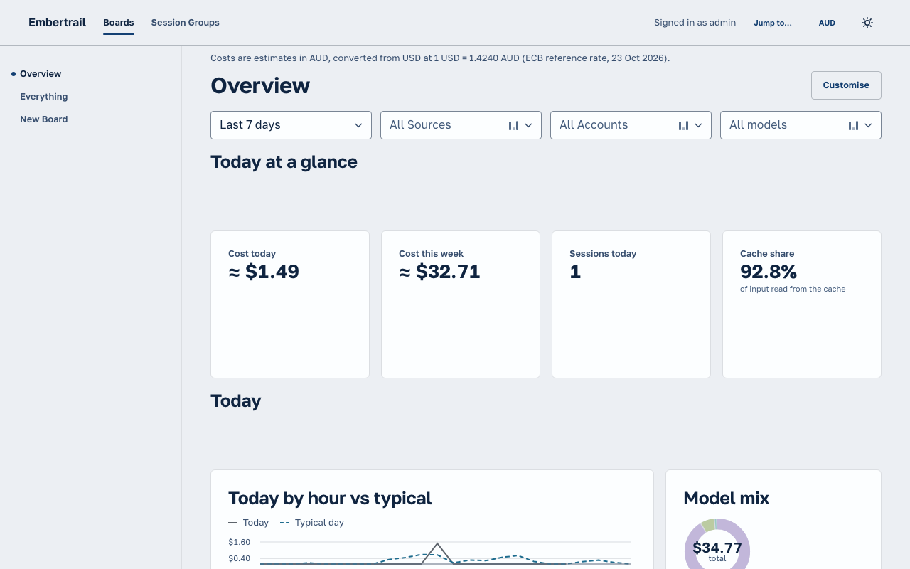

# Locale and currency

Claude Code reports cost in US dollars. The Dashboard writes numbers, dates and costs in the viewer's own locale and shows cost in their currency, converted at a published daily rate. This page records how, and why the rates come from the Hub.

## What the viewer sees

- **Locale** (numbers, dates, percentages) defaults to the browser's language (`navigator.language`). **Currency** defaults to the currency of that locale's region (`en-AU` reads AUD, `de-DE` reads EUR, a region without an ECB rate reads USD).
- The header's **language and currency** control overrides either. The choice is saved in this browser (`localStorage`, key `embertrail-dashboard-locale`) and follows no account: a solo Hub has no step to set it up, and a second device starts from its own browser.
- A converted cost is written `≈ A$12.40`, and a line above the page says what it is: _Costs are estimates in AUD, converted from USD at 1 USD = 1.5200 AUD (ECB reference rate, 23 Oct 2026)._ It is an estimate because Anthropic bills in USD and the card issuer's rate on the day differs from a reference rate.
- Charts are drawn from the converted values, so their axes are round numbers in the chosen currency.
- When the Hub has no rate for the chosen currency (switched off, never fetched, or the currency is not published), the Dashboard shows USD and a line says why. USD is what Claude Code sent, so it is never wrong, only less convenient.

The same Board in [USD](images/dashboard/locale/desktop-light-before-usd.png), and in AUD in [dark](images/dashboard/locale/desktop-dark-after-aud.png) and on a [phone](images/dashboard/locale/mobile-light-after-aud.png) (seeded `embertrail-demo` data, `en-AU`).

## Where the rates come from

**Decision:** the Hub fetches the European Central Bank's euro foreign exchange reference rates ([`eurofxref-daily.xml`](https://www.ecb.europa.eu/stats/eurofxref/eurofxref-daily.xml): keyless, free, about 30 currencies, published each working day around 16:00 CET), converts them to units per 1 USD, caches them in memory for six hours and serves them at `GET /api/v1/rates` (`getRates`, [`spec/query-api.yaml`](../spec/query-api.yaml)).

Why the Hub and not the browser:

- **Privacy.** A browser that called a rates API would tell that service its IP address and that it runs an Embertrail Dashboard, from every viewer. The Hub's request is a plain GET of a public file that carries nothing about the user, the Hub's data or its address beyond what any server's request carries. It is the only outbound request the Hub makes.
- **One contract.** The Dashboard reaches only the Hub's Query API (ADR 0010), and the Hub's nginx proxy and CORS rules stay unchanged. The Dashboard's lint ban on `fetch` stays.
- **Offline and self-hosting.** The Hub keeps the last good copy and serves it as `stale` when a refresh fails, retrying at most once a minute. A Hub that cannot reach the ECB and has no copy answers `unavailable`; the Dashboard falls back to USD. Setting `EXCHANGE_RATES=off` on the Docker Hub makes no request at all (`off`), for an air-gapped install.
- **Why not store rates.** Rates are reference data, not telemetry. Nothing is written to the database, so there is no retention, ownership or export story, and the cache is lost on restart (the next request refetches).

Rejected: a keyed commercial API (a secret to configure, which a solo install should not need); calling a rates API from the browser (privacy, above); bundling rates in a release (stale the day it ships); converting inside Claude Code's telemetry at ingest (a stored cost would then depend on a day's rate and never match Anthropic's bill).

Historical figures use **today's** rate, not the rate on the day of the spend, so a week's total is one consistent conversion. A past day's cost can therefore change a little from day to day. If per-day historical conversion is wanted, it needs the ECB's historical file and a decision on which rate a Session's cost uses; it is not done here.

## The Hub

`packages/hub/src/rates/rates.ts` holds the **Rates Port** (`RatesPort.get()` answers a status and a snapshot), `ecbRates()` (fetch, parse, cache, back off), `noRates()` (the default when a Platform passes none) and `parseEcb`. `createHub({ ports: { rates } })` takes it; `getRates` is a core op with auth `caller` (any authenticated caller, whatever Scopes the Token holds, a Source-bound Token refused, like `getSelf`) and no transaction.

`GET /api/v1/rates` answers 200 always, so a Dashboard has one shape to handle:

| `status`      | `rates` | Meaning                                              |
| ------------- | ------- | ---------------------------------------------------- |
| `ok`          | present | Fetched within the last six hours                    |
| `stale`       | present | The last good copy; the latest refresh failed        |
| `off`         | `null`  | This Hub makes no outbound request                   |
| `unavailable` | `null`  | Nothing fetched yet and the ECB could not be reached |

`base` is always `USD`, `date` is the ECB's publication day and `fetched_at` is when the Hub fetched it. The Docker server builds `ecbRates()` unless `EXCHANGE_RATES=off` ([`self-hosting.md`](self-hosting.md#configuration)). `apps/worker` is not built yet: its entry passes `ecbRates()` the same way (Workers have `fetch`; the cache is per isolate, so the Worker refetches at most every six hours per isolate).

## The Dashboard

`apps/dashboard/src/features/locale` owns it; `widgets` and `sessions` may import it, and it imports no other feature.

- `useLocale()` resolves the locale and the requested currency from the stored preferences and the browser.
- `useMoney()` joins that with `useRates()` (key `['rates']`, one hour) and returns `format(usd)`, `scale(usd)` and `plain(amount)`, and a `state` (`usd`, `loading`, `converted`, `fallback`). **Every cost in the Dashboard goes through it**: text uses `format`, a chart's data goes through `scale` and its `format` prop is `plain`. A new Widget that shows cost does the same; one that writes a number or date takes the locale from `useLocale()`, never `undefined` or a literal.
- While the rates load, USD shows and no note appears, so a stored AUD choice flashes USD for the first request of a session at most.
- `LocaleSettings` is the header control; `MoneyNote` is the line above the page (nothing when USD is shown).
- Chart axis labels for dates come from kiln-charts, which formats them in the browser's locale; a locale chosen in the Dashboard does not reach them yet (a Kiln change, tracked outside this repository).

Tests: `rates.test.ts` in the Hub (parsing, caching, back-off, stale, the endpoint), unit tests next to each module in `features/locale`, and `test/locale.test.tsx` renders widgets against the test Hub with AUD chosen.
